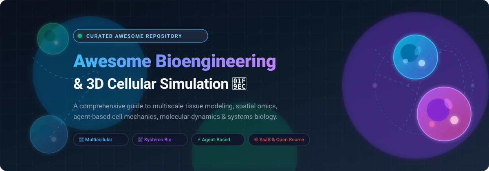

# Awesome Bioengineering &amp; 3D Cellular Simulation 🧬✨

  <strong>A curated list of elite open-source frameworks, agent-based simulators, molecular dynamics packages, and enterprise SaaS platforms for computational biology, 3D multicellular simulation, and tissue morphogenesis.</strong>

  
  
  
  
  
  

  <a href="#-sector-overview--market-dynamics">Sector Overview</a> •
  <a href="#-saas--hosted-platforms">SaaS Platforms</a> •
  <a href="#-open-source-github-projects">Open-Source Projects</a> •
  <a href="#-star-history">Star History</a> •
  <a href="#-how-to-contribute">Contributing</a> •
  <a href="#-support--sponsorship">Support</a>

---

## 📖 Introduction &amp; Scope

Bioengineering and **3D cellular simulation** tools enable researchers to model biochemical reaction networks, molecular docking, cell mechanics, tissue morphogenesis, and multiscale biological systems in silico. 

Whether you are performing **agent-based modeling** of tumor microenvironments (PhysiCell, Chaste, CompuCell3D), investigating spatial transcriptomics and tissue morphology (Squidpy, Scanpy), simulating cytoskeletal mechanics (MecaCell, CellSim3D), or orchestrating industrial-scale molecular dynamics (GROMACS, PyMOL), this repository serves as the definitive reference guide.

---

## 📊 Sector Overview &amp; Market Dynamics

The global computational biology and digital cellular simulation market was valued at approximately **$6.2 billion in 2024** and is projected to surge past **$16.5 billion by 2030** at a compound annual growth rate (CAGR) of ~14–17%, within an overarching cell biology and biopharma research tools industry exceeding **$20 billion**. 

Market concentration remains **moderately fragmented**: high-complexity biophysical and cellular simulation spans a diverse mix of enterprise life-science conglomerates (Dassault Systèmes, Schrödinger, Certara, MathWorks) dominating pharma-grade PK/PD, high-throughput screening, and molecular docking, specialized venture-backed SaaS platforms (Benchling) capturing workflow orchestration, and an essential academic/open-source consortium layer (PhysiCell, GROMACS, Scanpy, Chaste) driving cutting-edge multicellular physics and spatial omics innovation where no single winner takes all.

---

## 💼 SaaS / Hosted Platforms

Below is an enterprise comparison of commercial and hosted bioengineering, molecular modeling, and cellular simulation platforms, sorted by **Company Size (Revenue / Valuation, descending)**:

| Platform / Product | Company / Organization | Company Size (Revenue / Valuation) | Pricing 💳 | Free Tier Limits 🎁 | Key Capabilities &amp; Description 🔬 |
| :--- | :--- | :--- | :--- | :--- | :--- |
| **[BIOVIA](https://www.3ds.com/products/biovia)** | Dassault Systèmes (Euronext: DSY) | ~$7.2B annual revenue (~€7.0B) / ~$45B market cap | Starting from ~$15,000/year per specialized user module (custom enterprise quote) | 30-day trial for select modules upon corporate sales evaluation; no free forever tier | Multiscale virtual lab simulation suite (Pipeline Pilot, Materials Studio) for chemical, biological, and material modeling. |
| **[SimBiology](https://www.mathworks.com/products/simbiology.html)** | MathWorks | ~$1.5B annual revenue (Profitable private company) | Base MATLAB from $1,015/year + SimBiology toolbox from ~$1,500/year (commercial individual seat) | 30-day fully functional free trial (includes MATLAB, Simulink, and SimBiology toolbox); no free forever tier | Pharmacokinetic/pharmacodynamic (PK/PD) and biochemical systems modeling, ODE simulation, and parameter estimation. |
| **[Schrödinger Maestro](https://www.schrodinger.com/)** | Schrödinger, Inc. (NASDAQ: SDGR) | ~$1.72B market cap (~$200M+ annual revenue) | Academic tiers start from ~$7,500/year; commercial packages start from ~$25,000/year per seat | 30-day free trial on approval via sales inquiry; no free forever tier | Leading molecular modeling, docking (Glide), free energy perturbation (FEP+), and biophysical dynamics platform. |
| **[Certara Simcyp](https://www.certara.com/simcyp-pbpk/)** | Certara, Inc. (NASDAQ: CERT) | ~$1.8B market cap (~$380M annual revenue) | Software seat licensing starts from ~$16,000/year per product line; consortium pricing applies | 14-day to 30-day evaluation trial provided upon organizational compliance vetting; no free forever tier | Physiologically-based pharmacokinetic (PBPK) population-based mechanistic simulation platform for drug development. |
| **[Benchling](https://www.benchling.com/)** | Benchling, Inc. | ~$6.1B valuation (Private enterprise SaaS) | Startup/commercial tiers start from ~$15,000/year (billed annually); custom enterprise scaling | Free forever plan for academic researchers (limited to electronic lab notebook &amp; basic molecular biology sequence design; max 10GB storage) | Cloud-native R&D platform integrating molecular biology design tools, bioreactor tracking, and structured in-silico workflows. |
| **[ChimeraX Commercial](https://www.rbvi.ucsf.edu/chimerax/)** | UCSF Resource for Biocomputing (RBVI) | Academic institution licensing program ($10M+ programmatic licensing pool) | Commercial single-user license starts at $2,000 for a 3-year term (~$667/year equivalent) | Free forever for academic, educational, government, non-profit, and personal use without feature restriction | Molecular visualization, 3D structure analysis, cryo-EM density maps, and spatial macromolecular modeling. |
| **[Rosetta Commons Commercial](https://www.rosettacommons.org/)** | Rosetta Commons / UW CoMotion | Multi-institution academic consortium (~$5M+ licensing fund) | Starting from ~$10,000/year for companies with ≤200 FTEs; larger corporate tiers scaled via ramp fee | Free forever for academic, government, and non-profit institutions with full feature access | Advanced biomolecular and protein structure prediction, de novo macromolecular design, and docking algorithms. |
| **[BioUML Enterprise](https://www.biouml.org/)** | BIOSOFT.RU / Institute of Systems Biology | Boutique scientific software enterprise (<$5M estimated revenue) | Core software is AGPL-3.0 free; enterprise custom deployments &amp; support start from ~$5,000/project | Free forever for self-hosted community AGPL edition; public cloud demo server free with 50MB user storage limit | Integrated platform for systems biology, biological pathway diagramming, modular kinetic simulations, and parameter fitting. |

---

## 🧬 Open-Source GitHub Projects

Open-source alternatives and tools you can self-host, run locally, or extend. These cover agent-based multicellular modeling, spatial transcriptomics, molecular dynamics, biochemical networks, and 3D cell mechanics.

The table below is sorted by **GitHub Stars_Count (descending)**:

| Project 🧪 | GitHub_Stars ⭐ | Primary Focus &amp; Domain 🎯 | Language / Stack 💻 | License 📜 | Description 📝 |
| :--- | :---: | :--- | :--- | :--- | :--- |
| **[huangserva/3DCellForge](https://github.com/huangserva/3DCellForge)** |  | 3D Cell Modeling &amp; Presentation | TypeScript, React, Three.js | MIT | AI-assisted studio for generating, inspecting, and rendering realistic 3D cellular geometries and GLB biological assets. |
| **[scverse/scanpy](https://github.com/scverse/scanpy)** |  | Single-Cell &amp; Spatial Omics | Python, NumPy, SciPy | BSD-3-Clause | Comprehensive toolkit for analyzing single-cell gene expression and spatial omics data integrated with AnnData. |
| **[schrodinger/pymol-open-source](https://github.com/schrodinger/pymol-open-source)** |  | Molecular Visualization | Python, C++ | Python License | Open-source foundation of PyMOL for rendering high-fidelity 3D structural biology, macromolecular surfaces, and trajectories. |
| **[gromacs/gromacs](https://github.com/gromacs/gromacs)** |  | Molecular Dynamics Simulation | C++, CUDA, OpenCL | LGPL-2.1 | World-class molecular dynamics simulation engine optimized for proteins, lipids, nucleic acids, and membrane biophysics. |
| **[theislab/squidpy](https://github.com/theislab/squidpy)** |  | Spatial Cellular Biology | Python, AnnData | BSD-3-Clause | Spatial single-cell analysis framework to model cellular neighborhoods, spatial tissue graphs, and interactive image features. |
| **[RBVI/ChimeraX](https://github.com/RBVI/ChimeraX)** |  | 3D Molecular Graphics &amp; Analysis | Python, C++ | Non-commercial / UCSF | Next-generation molecular visualization environment for cryo-EM density maps, supramolecular assemblies, and sequence alignment. |
| **[MathCancer/PhysiCell](https://github.com/MathCancer/PhysiCell)** |  | Multicellular Agent-Based Physics | C++, OpenMP | BSD-3-Clause | Large-scale 2D/3D multicellular agent simulation engine modeling cell mechanics, cycling, apoptosis, and diffusing chemical microenvironments. |
| **[chaste/chaste](https://github.com/chaste/chaste)** |  | Tissue Morphogenesis &amp; Organ Simulation | C++, MPI, Python | BSD-3-Clause | High-performance computational biology library developed at Oxford for 3D cell-based tissue modeling and cardiac electrophysiology. |
| **[sys-bio/tellurium](https://github.com/sys-bio/tellurium)** |  | Systems Biology &amp; Biochemical Networks | Python | Apache-2.0 | Python environment for reproducible modeling, simulation, and parameter optimization of biochemical pathways and SBML standards. |
| **[virtualcell/vcell](https://github.com/virtualcell/vcell)** |  | Spatial &amp; Microscopic Cell Biology | Java, C++, Python | MIT | Comprehensive simulation environment for spatial and non-spatial reaction-diffusion networks, rule-based modeling, and electrophysiology. |
| **[copasi/COPASI](https://github.com/copasi/COPASI)** |  | Biochemical Network Simulation | C++, Qt | Artistic-2.0 | Biochemical pathway simulator supporting deterministic/stochastic algorithms, metabolic control analysis, and sensitivity analysis. |
| **[CompuCell3D/CompuCell3D](https://github.com/CompuCell3D/CompuCell3D)** |  | Multiscale Cellular Potts Modeling | C++, Python, Qt | MIT | Multiscale virtual tissue simulator based on the Cellular Potts Model (Glazier-Graner-Hogeweg) for morphogenesis and tumor evolution. |
| **[cellmodeller/CellModeller](https://github.com/cellmodeller/CellModeller)** |  | Multicellular Biofilms &amp; Plant Tissues | Python, OpenCL | MIT | GPU-accelerated biophysical simulation engine for cell growth, division, mechanical contact, and intercellular signaling in tissues. |
| **[megasonlab/goo](https://github.com/megasonlab/goo)** |  | 3D Embryo &amp; Cell Physics | Python, Blender | MIT | Blender-based programmatic library for realistic physics-driven simulations of cell division, cell-cell adhesion, and morphogenesis. |
| **[mcellteam/cellblender](https://github.com/mcellteam/cellblender)** |  | Cellular Microphysiology GUI | Python, Blender | GPL-2.0 | Blender addon serving as the visual interface and 3D cellular geometry pipeline for MCell particle-based simulations. |
| **[sys-bio/roadrunner](https://github.com/sys-bio/roadrunner)** |  | JIT-Compiled Kinetic Simulation | C++, LLVM, Python | Apache-2.0 | Ultra-fast JIT-compiling SBML simulation engine capable of deterministic and stochastic execution at peak computational speeds. |
| **[biosimulations/biosimulations](https://github.com/biosimulations/biosimulations)** |  | Biosimulation Platform &amp; Standards | TypeScript, Angular, Python | MIT | Central repository and web-based infrastructure for sharing, executing, and standardizing biological simulation experiments. |
| **[mcellteam/mcell](https://github.com/mcellteam/mcell)** |  | Monte Carlo Particle Microphysiology | C++, Python | MIT | Monte Carlo simulator tracking 3D stochastic diffusion and reactions of discrete molecules within complex sub-cellular ultrastructures. |
| **[PhysiBoSS/PhysiBoSS](https://github.com/PhysiBoSS/PhysiBoSS)** |  | Multicellular Agent Boolean Signaling | C++, MaBoSS | BSD-3-Clause | Extension of PhysiCell integrating stochastic Boolean signaling networks (MaBoSS) into individual agents for fate decision modeling. |
| **[jdisset/MecaCell](https://github.com/jdisset/MecaCell)** |  | Cellular Physics Engine | C++, OpenGL | LGPL-3.0 | Fast, modular C++ cellular engine for morphogenetic engineering, cell mechanical interactions, and collective behaviors. |
| **[opencmiss/zinc](https://github.com/opencmiss/zinc)** |  | Finite Element Bioengineering | C, C++, Python | MPL-2.0 | Core computational modeling and visualization engine of OpenCMISS for finite element bioengineering and anatomical field simulation. |
| **[SoftSimu/CellSim3D](https://github.com/SoftSimu/CellSim3D)** |  | GPU Cell Mechanics Simulation | CUDA, C++ | MIT | GPU-accelerated mechanical simulator modeling cell deformation, growth pressure, and spatial division dynamics in 3D. |

> 💡 **Quick Recommendations**:
> - 🔬 **Multicellular Tissue & Morphogenesis**: Start with **[PhysiCell](https://github.com/MathCancer/PhysiCell)**, **[Chaste](https://github.com/chaste/chaste)**, or **[CompuCell3D](https://github.com/CompuCell3D/CompuCell3D)**.
> - 🧪 **Biochemical Networks & Systems Biology**: Use **[COPASI](https://github.com/copasi/COPASI)**, **[Tellurium](https://github.com/sys-bio/tellurium)**, or **[VCell](https://github.com/virtualcell/vcell)**.
> - 🧬 **Molecular Dynamics & Structural Biology**: Pair **[GROMACS](https://github.com/gromacs/gromacs)** with **[PyMOL](https://github.com/schrodinger/pymol-open-source)** or **[ChimeraX](https://github.com/RBVI/ChimeraX)**.
> - 🗺️ **Spatial Omics & Tissue Graphs**: Combine **[Scanpy](https://github.com/scverse/scanpy)** and **[Squidpy](https://github.com/theislab/squidpy)**.

---

## 📈 Star History

---

## 🤝 How to Contribute

Contributions are welcome and deeply appreciated! 🌟

1. 🍴 **Fork** the repository
2. 🌿 Create a descriptive feature branch (`git checkout -b feature/amazing-bio-tool`)
3. 📝 Add your tool under the appropriate section (keep SaaS and Open-Source strictly separated)
4. 🏷️ Ensure open-source additions include their GitHub repository link and appropriate Stars_Badge
5. 🔍 Prefer actively maintained projects with clear documentation, reproducible examples, and cross-platform support
6. 🚀 Submit a well-documented **Pull Request**

---

## 💖 Support &amp; Sponsorship

Thank you for visiting and supporting the **Awesome Bioengineering &amp; 3D Cellular Simulation** knowledge base! 🧬

If you find this curated collection valuable for your research, academic studies, or industrial development:
- ⭐ **Star** this repository to help others discover it!
- 🍴 **Fork** it to keep a personal reference and contribute back!
- 📢 **Share** it with fellow bioengineers, systems biologists, and computational researchers!
- ☕ **Buy a coffee / Sponsor**: If you'd like to support ongoing curation and open-source maintenance, please consider sponsoring via the **[GitHub Sponsor Dashboard](https://github.com/sponsors/ishandutta2007)**!

---

## ⚠️ Disclaimer

This is a community-curated list for informational and educational purposes only.  
Inclusion does not constitute an official endorsement. Always review licenses, citation requirements, computational resource needs, and validation status before using any tool for research or publication.

Some projects may have dual licensing, academic-only free tiers, or commercial cloud offerings. Check the actual LICENSE file and official documentation. Simulation results should be carefully validated against experimental data.

---

  Made with ❤️ for the open-source bioengineering and computational biology community.

